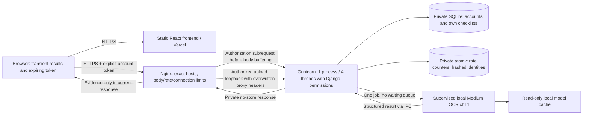

# Step 10: production preparation (not deployment)

Prepared on 23 October 2026. No infrastructure was provisioned, no application was
published, and the existing development database was not migrated or replaced.
Read the [readiness report](17_production_readiness_report.md) before public use.
The [privacy draft](18_privacy_retention_draft.md) describes implemented behavior
and operational choices still required.

## Architecture and trust boundaries



Nginx, Django and OCR share one Linux host initially. The frontend may be hosted
separately; OCR cannot run in a static Vercel deployment. Token credentials are
short-lived and stay in browser memory; no frontend environment variable contains
an access credential. The backend independently requires an active authenticated
account with the `models.analyze_document` permission. Public registration is
closed. Static guides/resources and liveness/readiness remain public; checklists
require authentication in production.

Use [Django's production checklist](https://docs.djangoproject.com/en/5.2/howto/deployment/checklist/)
as an additional operator reference. The profiles are:

- `config.settings_development`: explicit local/demo settings; DEBUG true, local
  hosts, optional anonymous OCR and legacy local anonymous checklist workflow.
- `config.settings_production`: DEBUG false, mandatory secret/hosts/origins/private
  paths, secure cookies and HTTPS; does not auto-load a `.env` file.
- `config.settings`: compatibility alias for development only. `manage.py` defaults
  to development; WSGI/ASGI default to production. The prepared Gunicorn config
  rejects a development settings module.

## Environment variables and secrets

Copy [backend/.env.production.example](../backend/.env.production.example) to a
private file outside the checkout, such as `/etc/japanxtheworld/backend.env`.
Keep it mode 0600; the service manager and administrators must be its only readers.
The systemd example reads it directly. For administrative commands, export its
values in a trusted shell without printing the environment. Never source a file
provided by an untrusted party.

| Variable | Production requirement |
| --- | --- |
| `DJANGO_SETTINGS_MODULE` | `config.settings_production` |
| `DJANGO_SECRET_KEY` | Newly generated random secret, at least 50 characters; no development/placeholder key |
| `DJANGO_DEBUG` | Omit or `false`; `true` aborts startup |
| `DJANGO_ALLOWED_HOSTS` | Comma-separated exact backend DNS hosts; no scheme, paths, wildcard or localhost |
| `DJANGO_CORS_ALLOWED_ORIGINS` | Exact HTTPS frontend origins, without trailing paths/slashes |
| `DJANGO_CSRF_TRUSTED_ORIGINS` | Exact HTTPS frontend/backend origins appropriate to the chosen hosts |
| `DJANGO_TRUSTED_PROXY_IPS` | Exact immediate proxy IPs; example `127.0.0.1,::1` |
| `DJANGO_STATE_DIR` | Private absolute directory outside the checkout, owned by app user, mode 0700 |
| `DJANGO_STATIC_ROOT` | Dedicated absolute public directory, separate from private state/models and containing no source checkout |
| `DOCUMENT_OCR_MODEL_ROOT` | Absolute directory containing the installed Medium detector and recognizer |
| `DJANGO_HSTS_INCLUDE_SUBDOMAINS` | Default false; enable only after all relevant subdomains are HTTPS |
| `DJANGO_HSTS_PRELOAD` | Default false; separate long-lived commitment, not needed to operate |

State paths derive from `DJANGO_STATE_DIR`: `app.sqlite3`, `rate-limits.sqlite3`,
`ocr-worker.lock`, and private `tmp/`. Database and rate-state files must be 0600.
Deploy checks reject unsafe state/tmp/database ownership or permissions and missing
model files. Create the directories as the dedicated service user before checking.
Do not serve any of these paths with a media alias.

Generate a new secret locally, for example with Python's
`secrets.token_urlsafe(64)`, and write it to the private environment file under
`umask 077`. Do not put the resulting value in a command argument, shell history,
Git, screenshots, frontend settings or this document.

**Rotation:** an earlier Django development key was committed in repository history.
Its removal from the current file does not make it secret. If that key was ever
used outside local development, replace it, invalidate affected Django sessions
and reset links, revoke existing DRF tokens, and rotate any reused credentials.
The production profile deliberately has no fallback to old keys. Token keys are
independent of Django's signing key, so changing `SECRET_KEY` alone does not revoke
them. Perform revocation in a planned maintenance window; this preparation did not
delete existing credentials or user data.

## Local development and verified commands

```sh
uv pip install --python backend/.venv/bin/python -r backend/requirements-dev.txt
backend/.venv/bin/python backend/manage.py check
backend/.venv/bin/python backend/manage.py test tests
npm ci
npm test
npm run build
```

For an existing development database, create a private backup before applying new
migrations. Then run `backend/.venv/bin/python backend/manage.py migrate` and start
`runserver --noreload`. That command uses development settings. The project database
was observed to be empty at this audit; the agent left it unchanged. All schema
application and rollback/restore exercises used disposable databases.

Local frontend `.env` may use `VITE_API_BASE_URL=http://localhost:8000/api`,
`VITE_USE_MOCK_API=false`, and `VITE_REQUIRE_AUTH=false`. For a deliberately isolated
mock demo use `VITE_USE_MOCK_API=true` with development or `vite build --mode demo`;
never publish that as a production/live decoder. Production builds reject mock mode
and an auth opt-out.

## Frontend build and separate hosting

[.env.production](../.env.production) supplies safe same-origin `/api` defaults.
A separate Vercel frontend needs public values from
[.env.production.example](../.env.production.example):

```text
VITE_API_BASE_URL=https://api.YOUR-DOMAIN/api
VITE_USE_MOCK_API=false
VITE_REQUIRE_AUTH=true
```

Replace the domain, then add that exact backend **origin** to `connect-src` in
[vercel.json](../vercel.json). Leave scripts restricted to self. The Vercel build
fails if the API URL is still `/api`, or if CSP omits its exact HTTPS origin. The
backend CORS origin and Nginx origin map must also match the real frontend origin.
Vercel's build command remains `npm run build`, output `dist`. The existing SPA
rewrites remain. Configure the backend URL before any real sign-in/upload; the
same-origin default is for a host that actually routes `/api` to Django.

Only four reviewed public `VITE_` variables are accepted at build time (API URL,
mock flag, auth UI flag, mock scenario). Other `VITE_` keys abort the build; HTTP or
localhost production APIs, credentials/query strings in URLs and live mock mode
are rejected. Server secrets must have no `VITE_` prefix. See
[Vite's environment-variable warning](https://vite.dev/guide/env-and-mode).

The sign-in panel is a small addition to the existing layout, not a redesign.
It uses an administrator-provided account. Credentials are sent only to the
configured login endpoint; tokens expire after one hour and are never placed in
browser storage or navigation history. Account changes clear analysis and checklist
state; in-flight responses for an old account are discarded. A reload requires
sign-in again. The client uses explicit Authorization headers and `credentials:
omit`; Django session authentication remains CSRF-protected for same-origin/admin
use. Cross-origin cookies are not enabled. No automatic OCR retry is performed.

## Database migration, access grants and recovery

The missing `rest_framework.authtoken` app is now installed so its upstream
migrations create token tables. Application migration `0002` adds the OCR permission;
`0003` adds the missing checklist category expected by the frontend. Existing rows
retain titles, dates, owners and completion state; a previously absent category
remains empty. Checklist IDs serialize as strings to match the frontend contract.
No migration history was reset or faked.

For the initial small single-host setup, private on-disk SQLite avoids another
service and paid database. Keep it on a local durable filesystem, not a shared
network mount. Separate atomic rate state from the account/checklist database.
Multiple app hosts, substantial writes or database-lock contention require a
planned move to self-hosted PostgreSQL (no paid service is required); that move is
not implemented here and must have its own backup/migration validation.

After provisioning/configuring a future host, as the app account, with production
variables exported and `umask 077`:

```sh
backend/.venv/bin/python backend/manage.py backup_database /PRIVATE-BACKUP-DIR/pre-migration.sqlite3
backend/.venv/bin/python backend/manage.py migrate --plan --settings=config.settings_production
backend/.venv/bin/python backend/manage.py migrate --noinput --settings=config.settings_production
backend/.venv/bin/python backend/manage.py migrate --check --settings=config.settings_production
backend/.venv/bin/python backend/manage.py check --deploy --settings=config.settings_production
backend/.venv/bin/python backend/manage.py collectstatic --noinput --settings=config.settings_production
```

For a genuinely new database, there is no existing snapshot to take first; create
its first backup after migration/account setup. The backup command uses SQLite's
consistent backup API, verifies integrity, creates a 0600 file in a 0700 directory
outside public/source paths, and refuses to overwrite a backup. It does not print
rows. Its temporary snapshot name is generated unpredictably and removed on error.

Create the first administrator using Django's interactive `createsuperuser` command.
Create normal pilot accounts using that administrator or a trusted management
shell; do not put passwords in command arguments. Grant/revoke a normal account:

```sh
backend/.venv/bin/python backend/manage.py grant_document_access ACCOUNT_NAME --settings=config.settings_production
backend/.venv/bin/python backend/manage.py grant_document_access ACCOUNT_NAME --revoke --settings=config.settings_production
```

Django group/superuser permissions still apply. Anonymous legacy checklist rows
are not exposed in production and are not silently assigned to a user or deleted.
Review ownership privately before any deliberate reassignment.

Backup/restore procedure:

1. Take a verified snapshot before schema/release changes and regularly thereafter.
   Proposed initial schedule: daily plus pre-change snapshots, seven daily and four
   weekly copies. This schedule is a proposal, not an installed automation.
2. Encrypt snapshots before off-host storage; keep the recovery key separate from
   the server, Git and application key. Use existing private storage/offline media
   if available; no backup service/account was purchased or connected.
3. Stop the application before recovery, preserve a snapshot of the current DB,
   and decrypt a chosen snapshot into a **new private recovery directory**. Never
   overwrite the only current database or backup.
4. Run `PRAGMA integrity_check`, inspect migration state and perform account/checklist
   tests against that disposable/restored copy. Restore the directory/file ownership
   and 0700/0600 modes. Test a sign-in and an account-scoped checklist read without
   dumping contents to logs.
5. During a controlled maintenance window, point the production state directory at
   the validated restored copy (named `app.sqlite3`), retaining the previous state
   directory. Restart, check readiness, and confirm access grants. Decide explicitly
   how to reconcile writes after the snapshot. Credentials present in an old backup
   may need revocation before serving it.

A disposable test applied migrations from an old nonempty checklist schema,
reapplied them without changes, backed up/restored, verified integrity, user login,
permissions and owned checklists. This proves that test workflow, not any future
provider backup service or recovery-time objective.

## WSGI server, model lifecycle and time limits

The prepared [Gunicorn config](../deploy/gunicorn.conf.py) selects one gthread
application process, four threads, a small socket backlog, bounded headers, no
application preload and no automatic POST replay. It refuses a non-loopback bind
in its configured default path. Operator CLI overrides must not expose it publicly.
The request handler starts a separate lazy OCR child; model imports/loading never
occur in the Gunicorn master. Do not add `--workers 2`, preload OCR, or run another
OCR instance alongside it on the same memory budget.

```sh
backend/.venv/bin/gunicorn --config deploy/gunicorn.conf.py config.wsgi:application
```

This is a future production command, not `runserver`. The
[systemd example](../deploy/japanxtheworld.service.example) adds a dedicated user,
0700/0600 defaults, private temporary space, disabled core dumps, read-only source
and model directories, no privilege escalation and loopback-only networking. Model
installation must happen separately before service startup. Its provisional whole-
service memory ceiling is 6500 MiB, distinct from the OCR child's 5 GiB guard.
Linux/systemd behavior remains an operator test; this file was not installed.

OCR settings remain Medium/Medium, batch1, CPU4, static backend, MKLDNN false,
detector cap1600, original-resolution recognition crops. The existing nonblocking
thread lock and host/path-wide lifetime lease permit one expensive job, with no
waiting queue. The lease file is empty and never unlinked while processes might
refer to its inode. Model instances are reused, then released after 120 seconds
idle or 64 requests. Multiple isolated containers/hosts do not share this lease;
future horizontal scaling needs explicit shared coordination and measured budgets.

The child processing limit is 120 seconds; the prepared proxy read timeout and
Gunicorn timeout are 150 seconds, and service stop allowance is 170 seconds.
Uploads have a separate 15-second proxy inter-read timeout. Nginx header/body/rate
and connection limits protect work before Django; the app's file streaming limits
and OS memory ceiling add independent bounds. A malicious slow client or distributed
traffic can still deny service; upstream network protection and monitoring are
necessary. These limits are not a complete DDoS defense.

WSGI cannot reliably cancel native OCR immediately when a browser disconnects.
An already-started job remains the only job, finishes or reaches its deadline/RSS
limit, and its response is discarded. The client must wait rather than duplicate
it. The local HTTP smoke disconnected one upload, observed a 503 during that job,
then a successful follow-up. Stop/restart kills the entire service process group;
recheck that no previous heavy child remains before starting another release.

## Reverse proxy, TLS and safe temporary handling

Use [nginx.conf.example](../deploy/nginx.conf.example) with its
[header include](../deploy/nginx-security-headers.conf.example). They are templates,
not an installed configuration. Replace backend/frontend domains, certificate and
static paths. Install the include at the indicated snippets path, validate with
`nginx -t`, and verify the auth-request module in `nginx -V`. System Nginx is not
installed on this Mac and the Docker daemon is unavailable. A private official
Nginx 1.30.6 build was therefore used on loopback: syntax, disposable-certificate
TLS verification, preflight/error CORS headers, 401/403 authorization before body
receipt, 413, concurrent 200/503, exact production-rate 401/401/429, overwritten
proxy identity and empty body-temp storage all passed against a controlled fake
API. This does not validate the future Linux package, public certificate or
systemd service. Repeat it on the intended host.

The example checks authorization using a GET subrequest before upload buffering;
the public access-check URL is blocked at the proxy. Only POST is admitted for OCR,
with one global active upload/inference connection and immediate 429/503 rejection
rather than an unbounded queue. Preflight is answered without a credential and
only the exact configured frontend gets CORS access. See Nginx's
[auth-request module](https://nginx.org/en/docs/http/ngx_http_auth_request_module.html)
and [request limiting](https://nginx.org/en/docs/http/ngx_http_limit_req_module.html).

The proxy overwrites forwarded TLS/client-IP headers. Django strips forwarded
identity from untrusted peers and never trusts frontend user IDs. Bind Gunicorn to
loopback, firewall its port, expose only HTTPS plus ACME HTTP and restricted SSH,
install a valid certificate, and monitor renewal. Initially administer Django via
an SSH tunnel or management commands; the proxy example denies public admin access.

The document limit is 10 MiB plus 64 KiB multipart overhead; OCR body buffering is
11 MiB with one active connection, keeping valid document bodies in RAM. Other API
bodies are capped at 64 KiB. Django requires bounded Content-Length in production;
clients using chunked transfer must be normalized/rejected at the proxy. Verify
this behavior in the intended HTTP/2/proxy setup. Authentication/body-header limits
run before document parsing; the full native parser is bounded in the child.

Document upload buffers are in memory and closed after success, corrupt input,
exceptions, timeout, memory rejection, overload and interrupted multipart parsing.
Pillow is restricted to allowed decoders; PDFium never executes a browser viewer.
Format signatures, allowed extensions, MIME disagreement, dimensions, decoded
pixels, pages, character/box/object counts and per-document raster totals are
checked. API metadata accepts only safe UTF-8/ASCII charsets, preventing exotic codec
decoding before the bounded parser. An allowed filename suffix is not evidence of
document type; supported suffix/content disagreement with generic MIME still uses
the real content decoder.
Unsupported suffixes are rejected. No file is published or saved by the decoder.

Prepare the fallback Nginx body-temp directory outside public paths, owned by its
worker with 0700, and Python private `tmp/` under the service user. Valid OCR bodies
fit the configured RAM buffer; fallback/cancellation cleanup must be checked on
Linux and alerted on if files accumulate. Do not delete active temporary files or
model lock inodes with a blanket cleanup job. The systemd private `/tmp` disappears
with its service namespace. Swap/core/disk encryption policy is an operator task;
RAM-only application handling does not guarantee secure erasure.

## Health, logging, monitoring and rollback

`GET /api/health` is liveness. `GET /api/ready` checks database migration state,
model files and private runtime directory readiness without loading a model or
returning internal paths; failure is a generic 503. Probe with the exact allowed
Host over HTTPS. Readiness is not an OCR accuracy test.

Application/Gunicorn logs contain only UTC time, level, fixed event/route categories,
status, allowlisted error code, processing duration and sampled RSS. They exclude
request objects, URLs, IPs, user IDs, filenames, credentials, source text and
tracebacks. No external error reporter is configured. Nginx metrics log only status
and durations; its unsanitizable error log is deliberately discarded. The loss of
verbose error diagnostics is an explicit privacy tradeoff; reproduce failures with
synthetic inputs in a private development environment instead of enabling production
request/debug dumps.

Monitor readiness/failures, 401/403 rates, 429/503 rejection counts, timeouts, worker
RSS and process count, OS/cgroup memory pressure, CPU, disk, SQLite lock errors,
backup integrity and certificate expiry. Proposed numeric-log retention is seven
days, enforced by future host/journal/logrotate configuration; no retention daemon
was installed. Keep system/core/proxy collectors from adding headers/body capture.
Do not send document evidence to analytics or session replay.

Rollback: stop traffic/application, preserve the current DB snapshot and private
configuration, select a previously verified **hardened** release with compatible
schema/dependencies, and switch the release path without deleting current data.
Run migration checks and readiness before restoring access. Prefer retaining the
additive schema over reversing migrations. A rollback to the earlier anonymous
Step 9 server is not safe for public access; keep the service offline if no secured
previous release exists. Restore a database only through the tested recovery plan
and an explicit decision about post-snapshot writes.

## Resource estimates, cost and scaling limits

Step 9 measured approximately 4.2 GiB worker RSS on the dense real sample and
4.30 GiB on the synthetic PDF/size suite, with 10.8 s cold / 9.6–9.8 s warm real
requests. These are Mac arm64 observations, not Linux/x86 guarantees. Step 10's
480×480 native compatibility smoke used under 1 GiB for its largest process; its
small image does **not** justify sizing a real-document server that small.

| Component | Planning allowance, not a measured Linux requirement |
| --- | ---: |
| OCR child | Up to 5 GiB guard, plus possible short sampled-limit overshoot |
| Django, threads, proxy and request buffers | 0.3–0.7 GiB |
| Minimal OS and service overhead | 0.7–1.0 GiB |
| Safety/allocator/burst headroom | 1.5–2 GiB |
| Total initial budget | Roughly 7.5–9 GiB; validate on Linux |

An **8 GiB** host is only a conditional pilot candidate after Linux measurement
with no competing workloads. It is not an established minimum. Prefer **12 GiB,
or a 16 GiB tier where that is the available option**, for initial production-like
validation. Use at least four vCPUs and keep inference CPU4/concurrency1 initially.
Reserve about 20–30 GiB disk for runtime/wheels, two releases, models, DB/backups
and updates; actual installed environment/model sizes and backup growth must be
measured. Weight files alone are about 133 MiB; runtime dependencies dominate disk
and inference buffers dominate RAM. Disk and CPU figures are estimates.

At roughly ten seconds per dense page the Mac's serial ceiling is about six such
pages/minute, before throttling or upload overhead. Shared cloud CPUs and five-page
PDFs may be slower. Do not multiply web workers to improve this ceiling. Upgrade
RAM/CPU and benchmark first; a future bounded OCR service/queue can be introduced
when workload evidence justifies it. GPUs, Kubernetes and paid inference APIs are
not required.

Published base-price examples checked on 23 October 2026 (not purchases/quotes):

| Candidate | Published resources | Monthly base | Decision limit |
| --- | --- | --- | --- |
| Hetzner CX33 EU | 4 vCPU, 8 GB, 80 GB NVMe | €8.49 excluding VAT/IPv4 | Conditional pilot only; product unavailable at lookup |
| Hetzner CX43 EU | 8 vCPU, 16 GB, 160 GB NVMe | €15.99 excluding VAT/IPv4 | More RAM for validation; product unavailable at lookup |
| DigitalOcean Basic Regular | 4 vCPU, 8 GiB, 160 GiB SSD | US$48 | Conditional pilot; performance unmeasured |
| DigitalOcean Basic Regular | 8 vCPU, 16 GiB, 320 GiB SSD | US$96 | Conservative validation tier; performance unmeasured |

Hetzner [specifications/availability](https://www.hetzner.com/cloud/cost-optimized/)
and [published price schedule](https://docs.hetzner.com/general/infrastructure-and-availability/price-adjustment/);
DigitalOcean [official pricing](https://www.digitalocean.com/pricing/droplets).
Recheck regional availability and taxes before choosing. Extra vCPUs do not
increase configured inference concurrency. Vercel plan eligibility/usage is not
priced here; do not assume any commercial workload qualifies for a free plan.

Use this worksheet for the actual decision: VM base + tax + IPv4/network/egress +
domain/DNS + frontend plan/usage + encrypted backup storage + monitoring/alerts +
operator maintenance. Add disk growth and recovery testing time. No managed DB,
GPU or metered AI inference cost is required by the code. No resource was purchased.

## Failures and final gates

- Missing secret/host/origin/private paths: production import fails; fix the private
  environment, never fall back to development.
- 401: missing/expired/revoked token; sign in again. 403: active account lacks the
  OCR permission or CSRF verification failed. Do not bypass the permission.
- 429: respect Retry-After; check account/IP policy. 503: busy worker, full/locked
  rate state, missing models or readiness failure; do not spawn another model.
- 413/504: document/memory/time limit; use a smaller supported input and investigate
  with synthetic data. Do not raise caps to hide a sizing issue.
- HTTPS redirect loop: wrong immediate proxy trust/header; verify the proxy boundary
  and firewall instead of disabling HTTPS.
- Browser CORS/CSP/network error: align exact frontend/API origins and preflight
  handling; do not enable wildcard CORS or add a browser secret.
- SQLite locks: inspect write/load patterns and disk; do not delete the DB or fake
  migrations. Consider a planned self-hosted PostgreSQL move.
- Deployment-check W005/W021: deliberate conservative HSTS defaults; verify every
  subdomain/preload requirement before opting in. They are not silenced.

Before any public deployment: configure real domains/secrets/accounts, establish
TLS/renewal and backups, validate Nginx/systemd on Linux, test cold/warm dense-image
and multi-page RSS after dependency updates, rerun security audits, and broaden
independently annotated real documents. The current accuracy corpus remains too
small for a production-accuracy claim.
