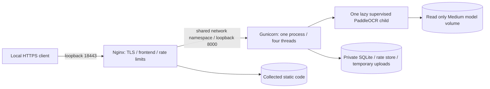

# Step 11: disposable Linux staging

Prepared 23 October 2026. This supplements [production preparation](16_production_preparation.md).
The [readiness report](20_staging_readiness_report.md) distinguishes executed macOS
tests from unexecuted Linux tests. Nothing here provisions a server or starts Docker Desktop.

## Architecture and isolation



`staging/compose.yaml` publishes only host loopback ports. Nginx shares the backend's
network namespace so the existing loopback proxy trust policy remains valid; port
8000 is never published. Only these two containers share that namespace. The private
Docker network is internal. Only the explicit model installer has an egress network.
Registration stays closed; login alone does not grant `models.analyze_document`.

The backend has 6500 MiB container memory, no additional swap allowance, four CPUs,
96 PIDs, a read-only root, no capabilities, and a non-root user. Its single OCR child
retains Medium/Medium, batch 1, CPU threads 4, detector side 1600, 5 GiB RSS cap,
120-second processing/idle limits, and 64-request recycling. Memory admission now
also observes Linux cgroup v1/v2 remaining memory. This is a sampled process guard,
not a guarantee against a fast native allocation or a kernel OOM kill.

Nginx has 128 MiB and private bounded tmpfs mounts. A separate setup-only root
container uses only ownership capabilities to initialize marked named volumes;
it does not receive credentials. The API receives only the signing-key file;
Nginx receives only the leaf certificate/key. No CA key or backup key is mounted.
File-backed Compose secrets are bind mounts, not an encrypted secret manager.
The generated container UID/GID matches the host owner so owner-only key files
remain readable without making them world readable. When preparing as root,
choose a dedicated non-root UID/GID explicitly. See [Compose secrets](https://docs.docker.com/compose/how-tos/use-secrets/).

State, official models, and collected static files occupy separate project-scoped
named volumes. Numeric container logs use a bounded local driver (5 MiB × 2 per
service). Upload bodies use private bounded filesystem locations and existing
cleanup. Raw OCR, images, credentials, query strings and personal results are not
logged. The OCR child shares the API's Unix identity, as in Step 10; it is not a
separate security principal. Do not expose this disposable stack publicly.

Dockerfiles copy explicit source files. `.dockerignore` excludes documents,
databases, credentials, caches and outputs, including accidental files under source
directories. Private fixtures are mounted only into an explicitly selected
benchmark container. No sample or local database is copied into an image.
Base multi-architecture manifests are pinned in `staging/images.lock.json`;
Python dependencies and npm lockfile are pinned. OS packages still resolve against
Debian repositories at build time; this is not a byte-for-byte reproducible image
or a completed image/CVE audit. Linux wheels exist for Python 3.12 on amd64/arm64,
but wheel availability does not prove native runtime compatibility.

## Prerequisites and preparation

Use a Linux Docker engine with Compose v2+ (configuration parsed here with Compose
v5.1.3). Install a lightweight host Python client separately if the backend venv is
unavailable: `python3 -m venv /private/path/client` then install
`staging/requirements-client.txt`. A Japanese-capable font and OpenSSL CLI are
required for synthetic HTTPS QA. Debian's `fonts-noto-cjk` is suitable.

From the checkout root, using the existing venv on this Mac:

```sh
PY=backend/.venv/bin/python
STAGE="$HOME/ocr_private_test/step11/linux-staging-new"
"$PY" staging/prepare.py "$STAGE" --platform linux/amd64
"$PY" staging/run.py --directory "$STAGE" config
"$PY" -m staging.preflight --require-linux
```

On this Mac, pass `--openssl /opt/homebrew/opt/openssl@3/bin/openssl`. On an ARM Linux
host select `--platform linux/arm64`; an amd64 image on Apple Silicon would be
emulated and must be labeled that way. On a root-run Linux host pass `--uid 10001
--gid 10001`, after checking the IDs are appropriate for that machine. Do not reuse
an existing directory: preparation refuses overwrites. Private folder modes are
0700, credentials 0600. `compose.env` contains public configuration and paths,
never secret values. Keep the whole folder outside Git and outside shared sync.

Preparation generates independent signing and backup keys, a two-day disposable
CA, and a leaf certificate for `api.staging.test` / `app.staging.test`. It does not
install a trust root. The test client explicitly trusts that CA and connects to
127.0.0.1 while verifying the intended TLS hostname. For manual browser use, configure
these two names to resolve to loopback and trust the disposable CA only in an
isolated test browser/profile. Do not use the test certificates for public TLS.

The guard requires at least 8 GiB currently available host memory and a Linux
Docker memory budget of at least 10 GiB. It never starts a VM. On the current 16 GiB
Mac, Docker was stopped and available RAM was approximately 4–4.6 GiB, with about
4 GiB already swapped; guarded execution correctly refused with exit 3. Free RAM
and configure Docker deliberately before reconsidering. Do not weaken the guard
or start several model-bearing stacks to obtain a passing benchmark.

## Build and initialize, on a suitable machine only

```sh
"$PY" staging/run.py --directory "$STAGE" build
"$PY" staging/run.py --directory "$STAGE" initialize
"$PY" staging/run.py --directory "$STAGE" models
"$PY" staging/run.py --directory "$STAGE" migrate
"$PY" staging/run.py --directory "$STAGE" test
"$PY" staging/run.py --directory "$STAGE" up
"$PY" staging/run.py --directory "$STAGE" status
"$PY" staging/validate_compose.py --directory "$STAGE"
```

All Linux build/run commands above remain unexecuted in this audit. `initialize`
refuses to adopt nonempty unmarked state or another project's volume. Model setup
downloads only official Medium weights, records the resolved revision and hashes,
and runs separately from requests. A fresh install resolves the current official
revision; preserve its installation manifests to reproduce the exact weights.
No inference service is contacted. API startup requires all production variables,
installed model files and current migrations. It does not apply migrations
implicitly. The runtime reads `STAGING_SECRET_FILE`, injects the key only into its
process environment, runs deployment checks, collects static code, and executes
Gunicorn. A missing/invalid signing key causes a generic startup failure.

Public settings: exact allowed host `api.staging.test`, exact HTTPS CORS frontend
origin, exact frontend/API CSRF origins, trusted proxy IPs 127.0.0.1/::1,
`DEBUG=False`, production state `/var/lib/japanxtheworld`, static `/srv/static`,
model root `/opt/models`. Only ports, project, private directory, UID/GID and Linux
platform are configurable through generated `compose.env`. See Compose for full
values. The frontend build receives only public `VITE_*` settings; mocks are off
and authentication is required. Never put a Django key into a frontend variable.

Health probes perform `/api/ready` with the exact host and trusted HTTPS protocol;
they check configuration/schema/model-file availability without loading a model.
`/api/health` is liveness. A healthy status does not establish OCR accuracy or native
inference compatibility. The HTTPS QA client creates two generated disposable
accounts through a private CLI, grants OCR permission to one, and holds credentials
in memory. It does not create a public fixture/control endpoint.

## HTTPS, CORS and HSTS

The generated Nginx configuration reuses production upload/auth/rate controls,
restricted hosts, proxy headers, security headers, TLS 1.2/1.3 and HTTP 308 redirects.
Token auth uses an Authorization header; browser tokens/results remain in memory.
Admin/session flows require CSRF and use Secure, HttpOnly, SameSite=Strict cookies.
Cross-origin token requests get only the explicit frontend origin. Untrusted origins
receive no CORS allowance. Only trusted proxy connections can establish HTTPS.

`security.W005` (includeSubDomains) and `security.W021` (preload) deliberately remain.
The API retains short, host-only HSTS. Public rollout needs a verified domain,
trusted certificate chain, renewal monitoring, redirect tests from real clients,
and an audited inventory of all subdomains before strengthening HSTS. Do not
silence the warnings or preload a test/unverified domain. The local CA validates
the test proxy chain, not public certificate issuance or renewal.

## Bounded performance and cleanup

Stop the stack before standalone model tests. The controller refuses a running
backend, proxy, installer, QA or benchmark service for these isolated operations.
The benchmark also shares the production model lease on the state volume.

```sh
"$PY" staging/run.py --directory "$STAGE" stop
umask 077
"$PY" staging/run.py --directory "$STAGE" benchmark > "$STAGE/linux-small.json"
"$PY" staging/run.py --directory "$STAGE" recycling > "$STAGE/linux-recycling.json"
```

The first runs three serial 480×480 synthetic images; the second forces recycling
after two requests and verifies the third loads a new worker. The report includes
actual OS/architecture/packages, initialization/inference/cold/warm time, 50 ms
sampled RSS, CPU utilization (100% means one core), cgroup memory current/peak,
reuse/recycling, end-RSS change and closure. Three requests are not a leak/soak test.
Reciprocal latency is a capacity illustration, not measured sustained throughput.
Kernel OOM and brief allocations can evade process sampling; inspect cgroup
`memory.events` and container exit state after a Linux test.

For representative private density, explicitly put an authorized/sanitized image
or PDF into `$STAGE/benchmark-inputs` and keep it owner-only. Then:

```sh
"$PY" staging/run.py --directory "$STAGE" --private-input document.png benchmark > "$STAGE/linux-representative.json"
```

The filename locates bytes only; it supplies no classification hint. This mode
retains 5 GiB RSS and production page/pixel/time limits, requires 5 GiB headroom,
and reports no document values or accuracy score. Repeat for a representative
sanitized scanned PDF, serially. Compare Linux dense results with Step 9, not only
the tiny synthetic fixture. Do not add a second worker or raise the cap on failure.

Host fallback actually executed in this audit:

```sh
"$PY" staging/validate_local.py --directory "$STAGE" --nginx /absolute/path/to/nginx --native
PYTHONPATH=backend "$PY" -m staging_tools.benchmark --small-synthetic --repeat 3 --output "$STAGE/mac-small.json"
PYTHONPATH=backend "$PY" -m staging_tools.benchmark --small-synthetic --repeat 3 --verify-recycling --output "$STAGE/mac-recycling.json"
```

Use a prepared directory and a locally installed Nginx with `http_auth_request_module`.
The fallback creates fresh private SQLite state per run, uses Gunicorn and verified
local HTTPS, samples resource use, stops servers in `finally`, verifies no retained
upload files/document rows, and validates backup recovery. It requires 3 GiB
available memory for its small fixtures and stops at 768 MiB host headroom. Never
run a native benchmark concurrently with the fallback. This is explicitly macOS
validation and does not fill the Linux measurement gap.

## Backup, restoration and rollback

`staging/backup.py` is restricted to explicitly prepared disposable directories.
It uses SQLite's consistent backup API, checks integrity, encrypts the database
bytes with authenticated Fernet, and publishes owner-only files atomically without
overwriting existing files. It is bounded to 128 MiB databases; use a separately
reviewed streaming solution beyond that. The archive contains intended DB records,
including account hashes and any retained tokens/sessions. It does not sweep up
server keys, model files, logs, images or temporary upload directories.
Keep the encryption key separate from the archive and protect both. See
[Fernet documentation](https://cryptography.io/en/latest/fernet/).

For the macOS fallback, use the recorded `local-qa-*` state directory:

```sh
"$PY" staging/backup.py seal --stage "$STAGE" --source "$STAGE/local-qa-RUN/state/app.sqlite3" --output "$STAGE/backups/manual.fernet" --key "$STAGE/secrets/backup_key"
"$PY" staging/backup.py restore --stage "$STAGE" --source "$STAGE/backups/manual.fernet" --output "$STAGE/recovery/app.sqlite3" --key "$STAGE/secrets/backup_key"
```

For a Linux named volume, stop backend/proxy first and export a consistent snapshot of the
database into a private staging subdirectory. Keep every path quoted:

```sh
set -e
umask 077
"$PY" staging/run.py --directory "$STAGE" stop
mkdir -m 700 "$STAGE/export"
docker compose --env-file "$STAGE/compose.env" -f staging/compose.yaml run --rm -T --no-deps --entrypoint python backend /app/backend/staging_tools/export_snapshot.py > "$STAGE/export/app.sqlite3"
"$PY" staging/backup.py seal --stage "$STAGE" --source "$STAGE/export/app.sqlite3" --output "$STAGE/backups/linux.fernet" --key "$STAGE/secrets/backup_key"
"$PY" staging/backup.py restore --stage "$STAGE" --source "$STAGE/backups/linux.fernet" --output "$STAGE/recovery/app.sqlite3" --key "$STAGE/secrets/backup_key"
```

Use `umask 077` before export. A named-volume import should use a **new prepared
project/state volume**, copy only the verified restored database while stopped,
set the configured UID/GID and mode 0600, run production `migrate --check`, then
start and verify login/checklist isolation and expired-token rejection. Do not
replace an existing database. This Linux import procedure remains unexecuted;
the complete actual restore/migration/login/checklist test used macOS disposable
state. Production recovery needs a timed drill and a token/session revocation
decision so rollback cannot revive credentials. Migrate forward deliberately only
after a backup; do not blindly reverse migrations.

Recommended future policy: encrypted daily backups, 7 daily + 4 weekly copies,
an additional encrypted off-host copy, separate recovery-key custody, monthly
restore drills and a backup before every schema change. Proposed initial RPO is
24 hours and RTO 30 minutes; these are targets, not validated production guarantees.
No scheduler or external storage service has been connected. Rotate numeric logs
at seven days once host operations exist; Compose currently enforces a byte cap,
not time retention. Remove disposable accounts/state only through a deliberate
operator cleanup after review; no `down -v` or database deletion is automated.

Rollback: stop this project, retain its DB/model installation manifests and
encrypted snapshot, rebuild the prior reviewed code in a new project directory,
verify schema compatibility on a copy, and run checks/HTTPS QA before switching.
Do not reuse signing keys in frontend builds or expose `.test` configurations.

## Final checks and larger accuracy evaluation

```sh
"$PY" backend/manage.py test tests --verbosity 1
"$PY" -m unittest staging.test_artifacts -v
"$PY" backend/manage.py check
"$PY" backend/manage.py makemigrations --check --dry-run
npm test
npm run build
npm audit --audit-level=low
uvx --python backend/.venv/bin/python --from pip-audit==2.10.1 pip-audit --path backend/.venv/lib/python3.12/site-packages --progress-spinner off
```

Production deployment checks also execute in the isolated HTTPS runner and the
configuration tests; running them without the mandatory environment must fail.
Do not point a development check at the staging volume or vice versa.

The private Step 9 dataset still has one partially annotated real document and
eleven synthetic images, no complete real transcription, and no complete real
false-positive denominator. New support starts up to fifty provided documents as
**unannotated**, with unknown category and `complete=false`, without copying or
modifying any source image:

```sh
PYTHONPATH=backend "$PY" -m evaluation.annotations --output "$HOME/ocr_private_test/new-evaluation/manifest.json" --provenance real_private /private/path/document1.png /private/path/document2.pdf
```

Have a human assign the runner's category names (national_health_insurance,
residence_tax, national_pension, school, utility, employment, municipal, unknown),
independently transcribe text, annotate all relevant dates/amounts/roles/labels,
primary/null expectations and extraction status before marking truth complete.
See Step 9's schema and commands. Use the selected production-equivalent profile,
`--profiles medium-side1600`,
`--max-rss-mib 5120 --timeout 120`, serial requests, and adequate memory; do not
use the old baseline profile's larger historical benchmark allowance for staging.
Score exact fields/labels and false positives only against complete ground truth.

Saved private predictions can receive an explicit human error-stage review:

```sh
PYTHONPATH=backend "$PY" -m evaluation.review template --metrics /private/run/metrics.json --predictions /private/run --output /private/run/review.json
PYTHONPATH=backend "$PY" -m evaluation.review apply --metrics /private/run/metrics.json --predictions /private/run --reviews /private/run/review.json --output /private/run/reviewed-metrics.json
PYTHONPATH=backend "$PY" -m evaluation.report /private/run/reviewed-metrics.json --output /private/run/reviewed-aggregate.csv
```

The reviewer marks each entry `reviewed=true` and uses only allowlisted
`ocr_recognition`, `field_extraction`, `interpretation` or `unresolved` stages and
categories. Prediction hashes bind reviews to exact saved results; changed outputs
require re-review. No free-text notes or copied document values enter the aggregate
publisher. Unreviewed error counts stay null, never zero. An extraction mismatch
alone does not establish an OCR root cause. Thirty to fifty independently labeled,
diverse real documents remain a prerequisite for an accuracy claim.
