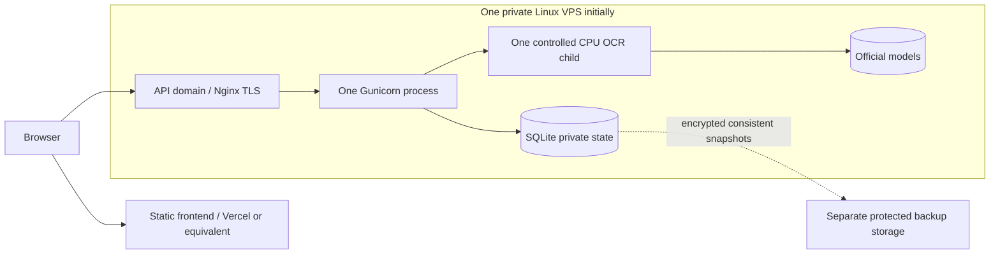

# Step 11 staging readiness report

23 October 2026. **Local macOS staging: CONDITIONAL GO for bounded private tests.
Linux/private server staging: NO-GO pending execution. Public production: NO-GO.**

The allowed fallback was used: Docker Desktop was stopped, its daemon socket was
unavailable, and the 16 GiB Mac had only about 4–4.6 GiB available RAM with roughly
4 GiB swapped. No VM was started, image built/pulled, Linux container run, server
purchased or public deployment performed. Docker Compose configuration validation
passed; that does not prove that its images build or run. The guarded benchmark
command refused with exit 3 as intended. Follow [the reproduction guide](19_linux_staging.md)
on an adequately resourced Linux environment to close this gap.

## Architecture and files

The prepared Compose stack contains Nginx TLS/static frontend, one Gunicorn process
with four threads, a lazy supervised PaddleOCR CPU child, separate SQLite state,
read-only official model storage and static-code volumes, and credential-scoped
bind-mounted secrets. Only loopback HTTP/HTTPS ports are published. Setup, QA and
benchmark profiles are explicit and isolated. A detailed diagram and resource
limits are in the guide. No frontend product design or extraction certainty rules
were changed. No paid inference or LLM was introduced.

| Files | Purpose |
| --- | --- |
| `.dockerignore`, `staging/{backend,frontend}.Dockerfile`, `staging/compose.yaml`, `staging/images.lock.json` | Source-only builds, pinned base manifests, bounded Linux topology |
| `staging/prepare.py`, `preflight.py`, `run.py`, `requirements-client.txt` | Private credential/config generation, memory/daemon guard, reproducible commands |
| `staging/validate_local.py`, `validate_compose.py`, `backup.py`, `test_artifacts.py` | Actual Mac HTTPS QA, prepared Linux HTTPS QA, encrypted disposable recovery tests |
| `backend/staging_tools/*.py`, `backend/models/management/commands/staging_control.py` | Fail-closed runtime, volume initialization, non-model health, bounded benchmarking, synthetic fixtures, private QA controls |
| `backend/services/ocr/{resources,worker}.py` | Host/cgroup memory guard and dead-worker channel cleanup |
| `backend/evaluation/{annotations,review,report}.py` | Up to fifty private unannotated inputs; prediction-bound manual error-stage review and numeric aggregates |
| `backend/tests/test_staging_*.py`, `staging_worker_targets.py`, `backend/requirements-dev.txt` | Resource/fault/evaluation tests and pinned backup test dependency |
| `docs/19_linux_staging.md`, this report, `step11_staging_aggregate.json` | Commands, operational plan and privacy-safe actual results |
| `README.md` | Entry points to staging instructions and current readiness |

Changes remain uncommitted. HEAD is `79ef497`, still two commits ahead of the cached
`origin/main`. The existing development DB remained zero bytes; the private sample's
size and modification time remained unchanged. New credentials, backups, test DBs,
logs and detailed outputs were kept outside the repository.

## Actual validation

| Check | Final observed result |
| --- | --- |
| Backend automated suite | **150 passed**, including 17 new cgroup/evaluation/fault tests; isolated Django test database |
| Host staging artifact/backup suite | **9 passed** |
| Frontend automated suite | **112 passed**, 7 files |
| TypeScript / Vite production build | Passed |
| Django system check | No issues |
| Migration drift check | No changes detected |
| Production settings / deployment check | Passed strict configuration tests and actual disposable production-profile startup; W005/W021 remain |
| Compose configuration | Passed `config --quiet` using generated private env; no secret values in Compose env |
| Local Gunicorn + Nginx HTTPS QA | **37 cases passed**, native PaddleOCR enabled, verified disposable TLS chain |
| Native bounded OCR benchmark | Three serial small-image requests; correct independently known synthetic fields, warm reuse, closed worker |
| Native recycling benchmark | Three requests, reuse on second, replacement after two on third, closed worker |
| JavaScript dependency audit | `npm audit`: zero known vulnerabilities reported |
| Python installed dependency audit | `pip-audit` 2.10.1 against Python 3.12 venv: zero known vulnerabilities reported |
| Additional static scan | Bandit 1.9.4: 67 low findings and 1 medium finding reviewed; no high findings |
| Linux image build, container QA, cgroup runtime/CPU/latency | **NOT EXECUTED** |
| Public certificate issuance/renewal, cloud recovery and production soak | **NOT EXECUTED** |

The scan includes QA assertions, subprocess imports/argument-list executions and
synthetic credential-like strings. Its one medium B108 finding is the generated
Nginx PID path `/tmp/nginx.pid`; Compose mounts a private owner-only 0700 tmpfs
there, and local QA replaces it with its private working path. No shell is used
for user-controlled arguments. This review is not a penetration test, container
image audit or native/OS CVE scan. Dependency audits report known advisories at
the time queried, not absence of all vulnerabilities.

During validation, the CORS harness expectation was corrected to the configured
204 preflight response; final HTTPS checks passed. An initial Python 3.13 audit
bootstrap failed in `ensurepip`; the successful audit explicitly used the project's
Python 3.12 installed environment. No unresolved automated test failure remains.

## Performance evidence and its limits

Actual host: macOS/Darwin arm64, Apple M4, 10 logical CPUs, 16 GiB RAM, Python
3.12.13, PaddlePaddle 3.2.0, PaddleOCR 3.7.0, PaddleX 3.7.2, Pillow 13.0.0.
Configuration: Medium/Medium, batch 1, CPU threads 4, detector side 1600, static
backend, MKLDNN disabled, 5 GiB child RSS cap. RSS sampled every 50 ms.

| Measurement | Step 11 small synthetic, final Mac run | Linux |
| --- | --- | --- |
| Workload | Explicit 480×480 Japanese generated image | Not run |
| Model initialization | 1.9457 s | Unmeasured |
| First complete request | 2.6233 s | Unmeasured |
| Warm requests | 0.5593 / 0.5605 s | Unmeasured |
| Median warm | 0.5599 s | Unmeasured |
| Sampled peak child RSS | 876.72 MiB | Unmeasured |
| Sampled CPU utilization | 71.5% cold; 91.6% / 92.7% warm (100%=one core) | Unmeasured |
| End RSS growth, request 1→3 | +0.46 MiB | Unmeasured |
| Container memory | Not applicable; JSON null | Unmeasured |
| Worker cleanup | Closed after run; no model-bearing servers left | Unmeasured |

Reciprocal warm latency is about 107 small images/minute, **not measured sustained
throughput**, and excludes admission/rate windows. The recycling run measured
2.5508 / 0.5566 / 1.7503 seconds, with a new model initialized for request three;
peak RSS 890.77 MiB. The HTTPS suite's sampled largest process was 900 MiB and
at most one process exceeded 512 MiB. Its native partial-image request took 2.6957 s,
unknown image 0.4547 s, and two-page scanned PDF 1.6862 s. These deliberately small
fixtures do not model real dense documents or prolonged allocator growth.

The [Step 9 dense Mac baseline](15_ocr_optimization_benchmark.md) remains about
4.2 GiB RSS, 10.8 s cold and 9.6–9.8 s warm; the PDF/size suite reached 4.30 GiB.
Small synthetic results do not supersede that evidence. There is no measured
Linux-vs-Mac ratio and no verified Linux throughput, cgroup headroom, OOM/restart,
long-run leak, native library compatibility or representative multi-page latency.
The prepared benchmark records those available counters without inventing zeros.

## Authentication, privacy and application workflows

Actual HTTPS cases cover closed registration; valid/invalid login; logout and
revoked tokens; explicitly expired tokens; unauthenticated checklist/OCR denial;
authenticated users without OCR permission; secure CSRF/session cookies; missing
CSRF rejection; explicit CORS preflight and rejection of untrusted origins; security
headers; HTTP 308 redirects for both origins; checklist create/read/update/delete
and cross-account read/write isolation; Life Guides/resources; and serving the
Document Decoder application entry point. This is HTTP/API integration plus the
frontend automated suite, not a complete browser visual/accessibility review.

Native upload checks independently verify English result fields, retained Japanese
evidence, a payment deadline separated from usage expiration, a verified payment
amount, **null primary amount**, partial status, unknown document nulls, and a
two-page scanned PDF. Invalid signatures and corrupt image/PDF data return safe
errors. Two simultaneous authorized uploads yield one success and one 503, without
a duplicate model. Rapid unauthenticated probes yield 401/401/429. No automatic
OCR retries occur. Stopping Gunicorn while leaving the proxy running returns a
generic 502 with no fabricated analysis or backend trace.

The automated fault suite additionally covers a genuinely exiting spawned worker
and subsequent recovery, simulated memory cancellation/recovery using a one-byte
test ceiling, hung-worker timeout/recovery, missing model files without download,
database exceptions/readiness 503, and simulated rate-store disk-full 503. These
tests do not exhaust physical RAM or fill a disk. A real Linux cgroup OOM/service
restart drill remains pending. Existing frontend tests cover safe backend-unavailable
and uncertainty/null handling.

Actual disposable state held zero Document/AnalysisResult rows, no retained upload
files, and only allowlisted operational log fields. Generated usernames/passwords
were absent from application logs and the server signing key/PEM private-key marker
was absent from frontend assets. Detailed results and database records are private;
the published aggregate contains case names/statuses and resource numbers only.

## TLS, database and recovery

Verified local TLS with a generated private CA, exact hostname validation and
Nginx TLS 1.2/1.3 configuration; HTTP redirects, forwarded HTTPS, response security
headers and secure cookie behavior passed. Public DNS, publicly trusted TLS,
renewal alerts and domain ownership remain blockers. W005 and W021 deliberately
remain; short host-only HSTS is retained without enabling preload or a long policy
for an unverified domain.

Production migrations ran on fresh private SQLite state, and a consistent,
authenticated encrypted snapshot restored to a **new disposable path**. Integrity
and current migrations passed; restored login and the checklist recovery sentinel
worked; an expired token stayed expired. The signing key was excluded from the DB
snapshot. The archive intentionally includes account/token/session DB records,
so it must stay encrypted and access-controlled. Tests reject wrong keys,
tampering, public key permissions, existing restore destinations and out-of-scope
databases. No development database was migrated, replaced or removed.

An additional recovery test verifies committed WAL pages are included. Exported
snapshots use a standalone DELETE-journal file, close connections before reading
bytes, and leave no temporary snapshot or sidecar files.

The guide supplies reproduction, named-volume export/import planning and rollback.
The Linux named-volume restore procedure is prepared but unexecuted. Daily encrypted
backups, separate off-host copies/key custody and monthly recovery drills are
recommendations; no external backup service or schedule was activated. Proposed
24-hour RPO / 30-minute RTO require an operational timed drill.

## Accuracy evaluation

Actual coverage was rechecked: **1 partially annotated real private document +
11 synthetic images; 0 complete real annotations; 0 real full transcriptions**.
Real-document accuracy, real false-positive rates and OCR error-rate coverage
remain incomplete. This step does not publish a new accuracy percentage or infer
an error cause from a missed field.

New manifests support up to fifty supplied real/anonymized inputs, initially
unannotated with no invented categories or ground truth. Existing scoring retains
exact field values/roles, label association, complete-truth false positives and
transcription metrics. Independent human reviews now distinguish OCR recognition,
field extraction and interpretation, with an unresolved stage for uncertain
causes. Reviews are bound to saved prediction hashes; unreviewed cause counts
remain null. Thirty to fifty diverse independently labeled real documents across
insurance, residence tax, pension, school, utility, employment, municipal and
unknown categories are still needed. Avoiding false deadlines/amounts remains
the acceptance priority. Synthetic fixtures are never relabeled as real evidence.

## Provisional hosting and monthly cost plan

This is an estimate derived from dense **Mac** evidence, not actual Linux staging
measurements. Four vCPUs and **12 GiB RAM, or a 16 GiB tier**, are a conservative
starting validation target. An 8 GiB host is only a conditional pilot candidate
after representative Linux measurement; no verified minimum exists yet. Budget
5 GiB for OCR, 0.3–0.7 GiB app/proxy, 0.7–1 GiB OS and 1.5–2 GiB safety headroom.
Keep the 6500 MiB service ceiling and one active OCR document; extra requests fail
busy rather than creating an unbounded queue. Multiple users can access lightweight
features, but simultaneous OCR capacity remains one. Existing per-user/IP/proxy
limits may constrain throughput before CPU does.

Reserve at least 20–30 GiB operational disk for images/wheels, two releases, models,
state, bounded logs and snapshots, then add measured dataset/backup retention.
The installed Medium directories measured about 59 MiB detector + 73 MiB recognizer
on this Mac; filesystem/library caches and Linux image size are additional and
unmeasured. Never bake user documents into a release image. No GPU or metered AI
inference is required.

| Monthly category | Planning treatment |
| --- | --- |
| Static frontend | Provider plan, bandwidth and build quotas; use an eligible low-cost tier and confirm terms |
| VPS compute/storage | Main recurring cost; benchmark CPU sharing and region latency before selecting |
| Domain / IPv4 / tax | Add registrar renewal, provider IP charge and applicable tax |
| Encrypted off-host backup | Snapshot size × retention + transfer/request charges; separate key custody |
| Monitoring / operations | Availability, latency, capacity/cgroup pressure, disk, backup age/integrity, TLS expiry, patching |

For a dated comparison only, DigitalOcean's official Basic Regular table checked
23 October 2026 lists 4 vCPU/8 GiB at US$48/month and 8 vCPU/16 GiB at US$96/month,
before additional services/tax. Neither was tested or purchased.
[Official pricing](https://www.digitalocean.com/pricing/droplets).
Hetzner's cost-optimized page showed constrained availability; obtain an actual
regional quote rather than assuming a listed entry tier can be ordered.
[Official availability](https://www.hetzner.com/cloud/cost-optimized/).

Scaling bottlenecks are dense native-memory usage, serial CPU OCR, maximum pages,
allocator retention/recycling, admission/rate limits and eventually SQLite writer
contention. First measure representative Linux load and scheduling; later scale
with explicit per-worker memory budgets and shared admission/rate coordination.
Do not increase Gunicorn process count casually: it can duplicate models. More
RAM alone does not establish correctness or production safety.

## Remaining gates

| Target | Assessment | Required next evidence |
| --- | --- | --- |
| Local bounded macOS staging | **CONDITIONAL GO** | Existing official models, adequate available memory, private fixtures, serial native work |
| Private Linux staging deployment | **NO-GO today** | Actual image build; suitable Linux resources; model/runtime compatibility; HTTPS QA; representative dense/PDF/cgroup/CPU benchmark; recovery drill |
| Public production | **NO-GO** | All Linux gates; sufficient independently annotated real accuracy/false-positive evaluation; verified public domain/TLS/renewal; secret custody; operated backup/restore/monitoring; reviewed privacy/retention and abuse controls; deliberate HSTS decision |

The reproducible configuration and allowed smaller tests are delivered. Linux
execution and public readiness remain explicitly unclaimed. No commit, push,
public deployment, infrastructure purchase or private-document publication occurred.
